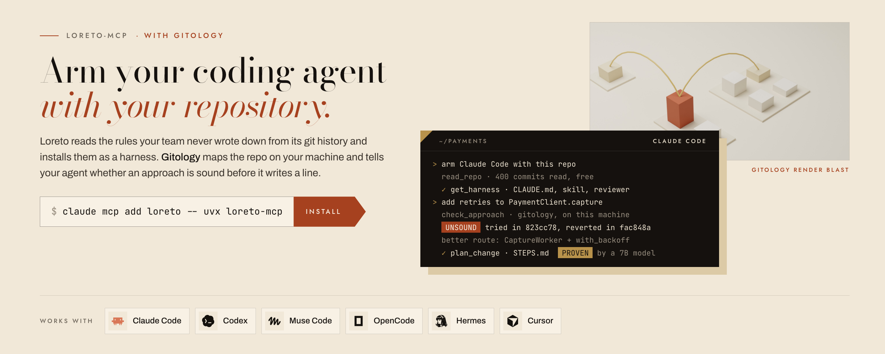

<p align="center">
  
</p>

# loreto-mcp

**Your code is your context.** Loreto reads your repository's code and git history and finds the four mistakes a coding agent keeps making there:

- **Anti-patterns:** code your team already added and reverted, and the "never" rules in your decision records. Guard rails block them.
- **Abstractions:** the modules the rest of the code imports. Your agent reuses them instead of writing a second one.
- **Deprecated code:** what is retired, what replaced it, and who still calls it. A new call gets a warning.
- **Simplification:** blocks copied between files, helpers defined many times, modules nothing imports.

Plus the rules nobody wrote down: where code goes, how big a change is, what has to change together. It installs all of it as a harness your coding agent loads, so every pull request it opens reads like your team wrote it.

Then, before your agent writes a line, **[Gitology](https://loreto.io/gitology)** tells it whether to build it that way in this repository, with the commits to prove it.

Works with **Claude Code, Codex, Muse Code, OpenCode, Hermes, Cursor, DeepSeek Harness, Antigravity and GitHub Copilot**.

---

## What the harness holds

Written from the repository's own history, with the figure behind every rule:

| File | Claude Code path | What it does |
|---|---|---|
| Root file | `CLAUDE.md` (or `AGENTS.md`) | Read on every session: what the repo is and the rules that matter most. Merged between `loreto` markers; your own file is kept. |
| Conventions skill | `.claude/skills/<repo>-conventions/SKILL.md` | How a change is made here: where code goes, sizing, naming, testing. |
| Reviewer | `.claude/agents/<repo>-conventions-reviewer.md` | Checks a change against the repo's own thresholds before a human has to. |
| References | `…/references/conventions.md`, `hotspots.md`, `coupling.md`, `lessons-from-reverts.md`, `anti-patterns.md`, `code-health.md` | The evidence: conventions, the files the work lands in, what moves together, what had to be undone, what not to put back, and what to reuse, retire and simplify. |
| Scripts | `…/scripts/guardrails.py`, `check-change.py`, `about.py` | Python, nothing to install. `guardrails.py` blocks reverted code and warns on deprecated calls; `check-change.py --strict` fails a git hook or CI run. |

Each agent gets its own layout (`AGENTS.md` + `.agents/skills/` for Codex and Muse Code, `.cursor/rules/` for Cursor, `~/.hermes/skills/` for Hermes). `list_agents` shows them.

## Pricing

Reading a repository and seeing what its harness would hold is **free**. The harness is **$5**, or **$2 a file** (three files cost the same as all of them). No subscription. Each purchase includes 25 questions to the repository.

---

## Install

```bash
claude mcp add loreto -- uvx loreto-mcp
```

Or in any MCP client config:

```json
{
  "mcpServers": {
    "loreto": { "command": "uvx", "args": ["loreto-mcp"] }
  }
}
```

No API key is needed for public repositories. To keep purchases on your Loreto account, and to read **private** repositories you have connected to Loreto through GitHub (read-only), add your key from [loreto.io/dashboard](https://loreto.io/dashboard):

```json
"env": { "LORETO_API_KEY": "lor_..." }
```

## Tools

| Tool | Cost | What it does |
|---|---|---|
| `list_agents` | free | The supported agents and where each reads its files. |
| `read_repo(repo, agent)` | free | Reads the history; returns what it says, the files, the prices and a `read_id`. |
| `buy_harness(read_id, agent, files?)` | $5 / $2 a file | Returns a Stripe checkout link **for the person to pay**. The agent cannot pay. |
| `get_harness(path)` | — | After payment: waits for the files and installs them into the repository at `path`. |
| `ask_repo(question)` | included | Why was this reverted? Who knows this code? Answered from the history. |
| `check_approach(approach, path?)` | free, local | Should I build it this way here? Good to go, risky or don't merge, with the evidence and a better route. Runs [Gitology](#gitology-ask-before-you-build). |
| `plan_change(request, path?)` | free, local | A change kit: `SPEC.md`, and `STEPS.md` small enough for a small model to build. Runs Gitology. |

A typical session:

> **You:** arm Claude Code with this repo
>
> **Agent:** *(read_repo)* Half of the last 400 commits touch 2 files or fewer… `src/api/routes.py` and `src/api/schema.py` changed together 17 times… The harness is $5. *(buy_harness)* Here is the checkout link.
>
> **You:** paid
>
> **Agent:** *(get_harness)* Armed Claude Code: `~ CLAUDE.md (kept yours, added the Loreto section)`, `+ .claude/skills/…`

## Gitology: ask before you build

[Gitology](https://loreto.io/gitology) maps a repository on your machine into a graph of what exists (modules, files, symbols, endpoints, tests, decision records, owners) and how it holds together (imports, changes-with, reverted-by, tested-by), and keeps it current through git hooks. `check_approach` and `plan_change` call it:

> **You:** add retries to PaymentClient.capture
>
> **Agent:** *(check_approach)* **DON'T MERGE.** This exact change was made in `823cc78`, captured cards twice, and was reverted in `fac848a`; ADR-014 says retries belong in workers. Better route: wrap the call in `CaptureWorker` with `with_backoff`. *(plan_change)* Kit written: 4 steps.

Install it once (Python 3.9+), and the tools find it:

```bash
curl -fsSL https://loreto.io/gitology/install.sh | sh
```

The graph is built locally. Only the verdict and the change kit call a model, they send it the excerpts and history that bear on the question, and the model can be local: set `GITOLOGY_MODEL=ollama:<model>`, or `ANTHROPIC_API_KEY` / `OPENAI_API_KEY` in the MCP server's `env`. Gitology also runs on its own as a CLI and MCP server: see [loreto.io/gitology](https://loreto.io/gitology).

## For agents with a wallet: x402

An agent holding USDC on Base can buy without a person or a browser, over [x402](https://www.x402.org). The harness is written **before** anyone pays, and the paid call answers with the files, so a payment settles only on a delivery:

```
POST https://api.loreto.io/api/v1/harness/prepare        {"repo": "...", "agent": "claude-code"}   free
GET  https://api.loreto.io/api/v1/harness/prepare/{id}   poll until "ready"                         free
POST https://api.loreto.io/api/v1/harness/x402           {"prepare_id": "..."}                      $5
POST https://api.loreto.io/api/v1/harness/x402/file      {"prepare_id": "...", "file": "skill"}     $2
```

Public repositories only. A harness that is not ready yet answers 409 and nothing is charged. Full walkthrough with a Python x402 client: [loreto.io/docs#x402](https://loreto.io/docs#x402). This MCP server does not sign payments.

## Changes in 1.1.1

`check_approach` speaks plain words: good to go, risky, don't merge, not sure (from Gitology's new labels).

## Changes in 1.1

`check_approach` and `plan_change`, through Gitology. Nothing else changed.

## Changes in 1.0

loreto-mcp used to wrap Loreto's skill generator and marketplace. Loreto is now about one thing, the harness, and the generator is no longer public. The `generate_skills`, catalog, `marketplace_*` and `agent_*` tools are gone; pin `loreto-mcp<1` if you depended on them.

---

[loreto.io](https://loreto.io) · [Gitology](https://loreto.io/gitology) · [Pricing](https://loreto.io/pricing) · MIT licence
