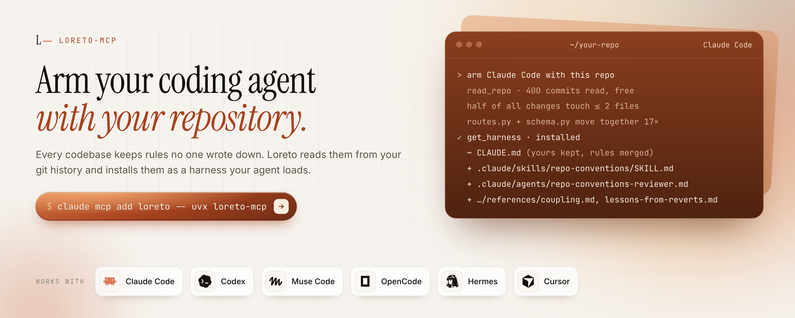

<p align="center">
  
</p>

# loreto-mcp

**Stop re-explaining your codebase.** Every codebase keeps rules no one wrote down: where code goes, how big a change is, what has to change together, what was reverted and why. Loreto reads them from your git history and installs them as a harness your coding agent loads, so every pull request it opens reads like your team wrote it.

Works with **Claude Code, Codex, Muse Code, OpenCode, Hermes and Cursor**.

---

## What the harness holds

Written from the repository's own history, with the figure behind every rule:

| File | Claude Code path | What it does |
|---|---|---|
| Root file | `CLAUDE.md` (or `AGENTS.md`) | Read on every session: what the repo is and the rules that matter most. Merged between `loreto` markers; your own file is kept. |
| Conventions skill | `.claude/skills/<repo>-conventions/SKILL.md` | How a change is made here: where code goes, sizing, naming, testing. |
| Reviewer | `.claude/agents/<repo>-conventions-reviewer.md` | Checks a change against the repo's own thresholds before a human has to. |
| References | `…/references/conventions.md`, `hotspots.md`, `coupling.md`, `lessons-from-reverts.md` | The evidence: conventions, the files the work lands in, what moves together, what had to be undone. |

Each agent gets its own layout (`AGENTS.md` + `.agents/skills/` for Codex and Muse Code, `.cursor/rules/` for Cursor, `~/.hermes/skills/` for Hermes). `list_agents` shows them.

## Pricing

Reading a repository and seeing what its harness would hold is **free**. The harness is **$5**, or **$2 a file** (three files cost the same as all of them). No subscription. Each purchase includes 25 questions to the repository.

---

## Install

```bash
claude mcp add loreto -- uvx loreto-mcp
```

Or in any MCP client config:

```json
{
  "mcpServers": {
    "loreto": { "command": "uvx", "args": ["loreto-mcp"] }
  }
}
```

No API key is needed for public repositories. To keep purchases on your Loreto account, and to read **private** repositories you have connected to Loreto through GitHub (read-only), add your key from [loreto.io/dashboard](https://loreto.io/dashboard):

```json
"env": { "LORETO_API_KEY": "lor_..." }
```

## Tools

| Tool | Cost | What it does |
|---|---|---|
| `list_agents` | free | The supported agents and where each reads its files. |
| `read_repo(repo, agent)` | free | Reads the history; returns what it says, the files, the prices and a `read_id`. |
| `buy_harness(read_id, agent, files?)` | $5 / $2 a file | Returns a Stripe checkout link **for the person to pay**. The agent cannot pay. |
| `get_harness(path)` | — | After payment: waits for the files and installs them into the repository at `path`. |
| `ask_repo(question)` | included | Why was this reverted? Who knows this code? Answered from the history. |

A typical session:

> **You:** arm Claude Code with this repo
>
> **Agent:** *(read_repo)* Half of the last 400 commits touch 2 files or fewer… `src/api/routes.py` and `src/api/schema.py` changed together 17 times… The harness is $5. *(buy_harness)* Here is the checkout link.
>
> **You:** paid
>
> **Agent:** *(get_harness)* Armed Claude Code: `~ CLAUDE.md (kept yours, added the Loreto section)`, `+ .claude/skills/…`

## For agents with a wallet: x402

An agent holding USDC on Base can buy without a person or a browser, over [x402](https://www.x402.org). The harness is written **before** anyone pays, and the paid call answers with the files, so a payment settles only on a delivery:

```
POST https://api.loreto.io/api/v1/harness/prepare        {"repo": "...", "agent": "claude-code"}   free
GET  https://api.loreto.io/api/v1/harness/prepare/{id}   poll until "ready"                         free
POST https://api.loreto.io/api/v1/harness/x402           {"prepare_id": "..."}                      $5
POST https://api.loreto.io/api/v1/harness/x402/file      {"prepare_id": "...", "file": "skill"}     $2
```

Public repositories only. A harness that is not ready yet answers 409 and nothing is charged. Full walkthrough with a Python x402 client: [loreto.io/docs#x402](https://loreto.io/docs#x402). This MCP server does not sign payments.

## Changes in 1.0

loreto-mcp used to wrap Loreto's skill generator and marketplace. Loreto is now about one thing, the harness, and the generator is no longer public. The `generate_skills`, catalog, `marketplace_*` and `agent_*` tools are gone; pin `loreto-mcp<1` if you depended on them.

---

[loreto.io](https://loreto.io) · [Pricing](https://loreto.io/pricing) · MIT licence
